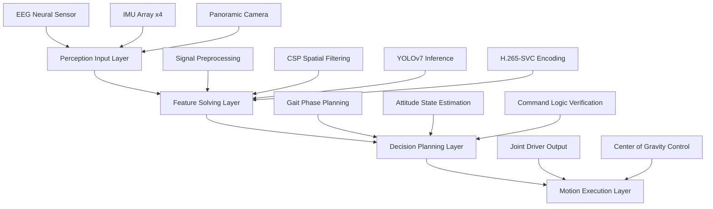

<div align="center">

#  CyberLife
### *Embodied Bionic Carrier Cognitive Software System*

---


> **Designed by CyberLife**
> *Bridging machine and life through embodied intelligence.*

</div>

---

## 📖 Table of Contents

- [Overview](#-overview)
- [System Architecture](#-system-architecture)
- [Core Subsystems](#-core-subsystems)
- [Tech Stack](#-tech-stack)
- [Project Structure](#-project-structure)
- [Quick Start](#-quick-start)
- [Development Guide](#-development-guide)
- [Roadmap](#-roadmap)

---

## 🔭 Overview

**CyberLife** is an **embodied cognitive software stack** designed for multi-limb bionic carriers. It constructs a complete *perception-decision-execution closed-loop*, endowing physical hardware with environmental awareness, multimodal interaction capabilities, and autonomous locomotion control.

The system is built on a modular, loosely-coupled architecture, allowing each subsystem to be developed, tested, and iterated independently. It targets unstructured terrain operation scenarios, integrating rhythmic bionic gait generation, multimodal biosignal interaction, and panoramic environmental perception with robust media transmission.

```
┌─────────────────────────────────────────────────────────┐
│                    CyberLife Cognitive Core              │
├─────────────┬──────────────────┬───────────────────────┤
│  Locomotion │  Multimodal I/O  │  Environmental Perception │
│  Subsystem  │  Subsystem       │  Subsystem            │
└─────────────┴──────────────────┴───────────────────────┘
         ↓                   ↓                    ↓
    Joint Actuators    EEG / IMU Sensors    Panoramic Camera
```

---

## 🏗 System Architecture

The system follows a **four-layer hierarchical architecture**:



### Layer Responsibilities

| Layer | Module | Description |
|-------|--------|-------------|
| **Perception Input** | Sensor Abstraction | Unified interface for EEG, IMU, and vision sensors |
| **Feature Solving** | Signal Processing | EEG preprocessing, spatial filtering, object detection, video encoding |
| **Decision Planning** | Motion Planner | Gait generation, attitude estimation, command validation |
| **Motion Execution** | Actuator Driver | Joint control, dynamic CoG adjustment, closed-loop feedback |

---

## ⚙ Core Subsystems

### 1. 🦿 Bionic Locomotion Subsystem

The motion execution foundation of the embodied carrier. Implements multiple rhythmic bionic gait patterns for multi-limb platforms.

#### Supported Gait Patterns

| Gait Type | Phase | Stability | Speed | Use Case |
|-----------|-------|-----------|-------|----------|
| **Wave Gait** | 1/8 phase offset | ⭐⭐⭐⭐⭐ | Slow | Rough terrain, high stability |
| **Alternating Gait** | Diagonal pairs | ⭐⭐⭐⭐ | Medium | Normal terrain, balanced |
| **Triangle Gait** | Tripod support | ⭐⭐⭐⭐⭐ | Medium | Static stability guaranteed |
| **Rotation Gait** | In-place rotation | ⭐⭐⭐⭐ | Fast | Direction adjustment |

#### Core Algorithm Snippet

```python
# src/gait_system/triangle_gait.py
import numpy as np
from dataclasses import dataclass

@dataclass
class GaitPhase:
    """Gait phase state machine for multi-limb locomotion."""
    swing_legs: list
    stance_legs: list
    phase_offset: float
    cycle_period: float

class TriangleGaitGenerator:
    """
    Implements tripod gait generation for 8-limb bionic platform.
    Divides legs into two alternating groups for static stability.
    """
    def __init__(self, num_legs: int = 8, freq: float = 1.0):
        self.num_legs = num_legs
        self.freq = freq
        self.phase = 0.0
        # Group A: legs 0,2,5,7 | Group B: legs 1,3,4,6
        self.group_a = [0, 2, 5, 7]
        self.group_b = [1, 3, 4, 6]

    def update(self, dt: float) -> np.ndarray:
        """Compute joint angles for all legs at current timestep."""
        self.phase = (self.phase + self.freq * dt) % (2 * np.pi)
        joint_angles = np.zeros((self.num_legs, 3))

        for leg in range(self.num_legs):
            if leg in self.group_a:
                local_phase = self.phase
            else:
                local_phase = self.phase + np.pi

            # Swing trajectory: parabolic foot lift
            if np.sin(local_phase) > 0:
                joint_angles[leg] = self._swing_trajectory(local_phase)
            else:
                joint_angles[leg] = self._stance_trajectory(local_phase)

        return joint_angles

    def _swing_trajectory(self, phase: float) -> np.ndarray:
        """Parabolic swing trajectory with foot clearance."""
        lift_height = 0.05 * np.sin(phase)
        forward = 0.1 * np.cos(phase)
        return np.array([forward, lift_height, 0.0])
```

#### Center of Gravity Control

```python
# src/gait_system/center_of_gravity.py
import numpy as np

class DynamicCoGController:
    """
    Real-time center of gravity migration control.
    Maintains stability margin during locomotion on uneven terrain.
    """
    def __init__(self, safety_margin: float = 0.2):
        self.safety_margin = safety_margin
        self.current_cog = np.array([0.0, 0.0, 0.0])

    def compute_stability_margin(self, support_polygon: np.ndarray) -> float:
        """Calculate stability margin based on support polygon geometry."""
        projected = self.current_cog[:2]
        distances = []
        for i in range(len(support_polygon)):
            p1 = support_polygon[i]
            p2 = support_polygon[(i + 1) % len(support_polygon)]
            d = self._point_to_line_distance(projected, p1[:2], p2[:2])
            distances.append(d)
        return min(distances) - self.safety_margin
```

---

### 2. 🧠 Multimodal Biosensing Interaction Subsystem

Dual-channel perception control paradigm supporting both **BCI neural interaction** and **IMU inertial attitude feedback**.

#### Channel A: EEG Brain-Computer Interface

Non-invasive EEG signal processing pipeline with CSP spatial filtering and deep feature extraction.

```python
# src/bci_imu_system/eeg_process.py
import numpy as np
from scipy import signal

class EEGPreprocessor:
    """
    EEG signal preprocessing pipeline:
    1. Baseline correction
    2. Bandpass filtering (8-30Hz mu/beta rhythm)
    3. Artifact rejection (EOG/EMG removal)
    4. Epoching around event markers
    """
    def __init__(self, fs: int = 250):
        self.fs = fs
        self.bp_filter = signal.butter(
            4, [8, 30], btype='bandpass', fs=fs
        )

    def process(self, raw_eeg: np.ndarray, events: list) -> np.ndarray:
        """Process raw EEG and extract epochs."""
        baseline = np.mean(raw_eeg, axis=1, keepdims=True)
        corrected = raw_eeg - baseline
        filtered = signal.filtfilt(
            self.bp_filter[0], self.bp_filter[1], corrected, axis=1
        )
        epochs = []
        for event_time in events:
            start = int((event_time - 0.2) * self.fs)
            end = int((event_time + 0.8) * self.fs)
            if start >= 0 and end < filtered.shape[1]:
                epochs.append(filtered[:, start:end])
        return np.array(epochs)
```

```python
# src/bci_imu_system/csp_svm_cnn.py
from sklearn.svm import SVC
import numpy as np

class CSPSpatialFilter:
    """
    Common Spatial Pattern (CSP) filter for EEG feature enhancement.
    Maximizes variance between two motor imagery classes.
    """
    def __init__(self, n_components: int = 6):
        self.n_components = n_components
        self.filters_ = None

    def fit(self, epochs: np.ndarray, labels: np.ndarray):
        """Compute CSP spatial filters from labeled epochs."""
        class_0 = epochs[labels == 0]
        class_1 = epochs[labels == 1]
        cov_0 = np.mean([np.cov(e) for e in class_0], axis=0)
        cov_1 = np.mean([np.cov(e) for e in class_1], axis=0)
        eig_vals, eig_vecs = np.linalg.eig(
            np.linalg.inv(cov_0 + cov_1) @ cov_1
        )
        sorted_idx = np.argsort(np.abs(eig_vals - 0.5))
        self.filters_ = eig_vecs[:, sorted_idx[:self.n_components]]

    def transform(self, epochs: np.ndarray) -> np.ndarray:
        """Project epochs onto CSP subspace and extract log-variance features."""
        projected = np.array([self.filters_.T @ e for e in epochs])
        features = np.log(np.var(projected, axis=2))
        return features
```

#### Channel B: IMU Multi-Sensor Attitude Fusion

```python
# src/bci_imu_system/imu_fusion.py
import numpy as np
from filterpy.kalman import KalmanFilter

class QuadIMUAttitudeFusion:
    """
    Multi-IMU array attitude fusion using extended Kalman filter.
    Fuses data from 4 gyroscopes + accelerometers for robust pose estimation.
    """
    def __init__(self, num_imus: int = 4):
        self.num_imus = num_imus
        self.kf = self._build_kalman_filter()

    def _build_kalman_filter(self) -> KalmanFilter:
        """State: [roll, pitch, yaw, roll_rate, pitch_rate, yaw_rate]"""
        kf = KalmanFilter(dim_x=6, dim_z=6)
        kf.x = np.zeros(6)
        kf.F = np.eye(6)
        kf.H = np.eye(6)
        kf.R = np.eye(6) * 0.01
        kf.Q = np.eye(6) * 0.001
        return kf

    def update(self, gyro_data: np.ndarray, accel_data: np.ndarray) -> np.ndarray:
        """Fuse multi-IMU readings and output fused attitude."""
        avg_gyro = np.mean(gyro_data, axis=0)
        dt = 0.01
        self.kf.F[0, 3] = dt
        self.kf.F[1, 4] = dt
        self.kf.F[2, 5] = dt
        self.kf.predict()
        accel_attitude = self._accel_to_attitude(accel_data)
        z = np.concatenate([accel_attitude, avg_gyro])
        self.kf.update(z)
        return self.kf.x[:3]
```

---

### 3. 👁 Panoramic Environmental Perception Subsystem

Environmental information acquisition, analysis, and remote transmission pipeline.

#### YOLOv7 Object Detection (Animal Classes Removed)

```python
# src/vision_system/yolo_detect.py
from ultralytics import YOLO
import numpy as np

# Custom class list - animal classes REMOVED per requirements
# Only obstacle/object classes retained
PERCEPTION_CLASSES = [
    'person',
    'bicycle', 'car', 'motorcycle', 'bus', 'truck',
    'chair', 'couch', 'bed', 'dining table',
    'door', 'window', 'wall', 'fence',
    'rock', 'tree', 'pole', 'sign',
    'backpack', 'umbrella', 'handbag',
]

# NOTE: All animal classes (bird, cat, dog, horse, sheep, cow, elephant,
# bear, zebra, giraffe, etc.) have been REMOVED from detection scope.

class PanoramicDetector:
    """
    Wrapper for YOLOv7 inference on panoramic camera feed.
    Detection logic encapsulated as standalone callable function.
    Animal categories excluded per system requirements.
    """
    def __init__(self, model_path: str = 'yolov7.pt'):
        self.model = YOLO(model_path)
        self.allowed_classes = self._build_class_filter()

    def _build_class_filter(self) -> list:
        """Map custom class names to COCO class indices."""
        coco_names = self.model.names
        return [k for k, v in coco_names.items() if v in PERCEPTION_CLASSES]

    def detect(self, frame: np.ndarray, conf_threshold: float = 0.5) -> list:
        """
        Run object detection on input frame.
        Returns list of detections: [bbox, class_name, confidence]
        """
        results = self.model(frame, conf=conf_threshold, verbose=False)
        detections = []
        for r in results:
            boxes = r.boxes
            for box in boxes:
                cls_id = int(box.cls)
                if cls_id not in self.allowed_classes:
                    continue
                x1, y1, x2, y2 = box.xyxy[0].tolist()
                conf = float(box.conf)
                cls_name = self.model.names[cls_id]
                detections.append({
                    'bbox': [x1, y1, x2, y2],
                    'class': cls_name,
                    'confidence': conf
                })
        return detections
```

#### H.265-SVC Scalable Video Coding

```python
# src/vision_system/h265_svc_codec.py
import subprocess
import numpy as np

class H265SVCEncoder:
    """
    H.265/SVC layered encoding for panoramic video.
    Provides adaptive bitrate based on depth-of-field:
    - Base layer: low resolution, wide FOV
    - Enhancement layer: high resolution, near-field detail
    """
    def __init__(self, base_bitrate: int = 500, enhance_bitrate: int = 2000):
        self.base_bitrate = base_bitrate
        self.enhance_bitrate = enhance_bitrate

    def encode_layer(self, frame: np.ndarray, layer: str = 'base') -> bytes:
        """
        Encode a single frame to H.265 NAL unit.
        layer: 'base' (low bitrate, far view) or 'enhance' (high bitrate, near view)
        """
        bitrate = self.base_bitrate if layer == 'base' else self.enhance_bitrate
        cmd = [
            'ffmpeg', '-y',
            '-f', 'rawvideo', '-vcodec', 'rawvideo',
            '-s', f'{frame.shape[1]}x{frame.shape[0]}',
            '-pix_fmt', 'bgr24',
            '-i', '-',
            '-c:v', 'libx265',
            '-b:v', f'{bitrate}k',
            '-tune', 'zerolatency',
            '-f', 'hevc',
            'pipe:1'
        ]
        proc = subprocess.Popen(
            cmd, stdin=subprocess.PIPE, stdout=subprocess.PIPE
        )
        out, _ = proc.communicate(frame.tobytes())
        return out
```

#### FEC Forward Error Correction

```python
# src/vision_system/fec_transmit.py
import numpy as np

class FECPacketSender:
    """
    Reed-Solomon based forward error correction for video streaming.
    Protects against packet loss in unreliable network conditions.
    """
    def __init__(self, data_shards: int = 4, parity_shards: int = 2):
        self.data_shards = data_shards
        self.parity_shards = parity_shards

    def encode(self, packet: bytes) -> list:
        """Generate FEC parity packets for a media frame."""
        shard_size = len(packet) // self.data_shards
        data = [
            packet[i*shard_size:(i+1)*shard_size]
            for i in range(self.data_shards)
        ]
        parity = []
        for p in range(self.parity_shards):
            parity_shard = bytearray(shard_size)
            for s in range(self.data_shards):
                if (s >> p) & 1:
                    for j in range(shard_size):
                        parity_shard[j] ^= data[s][j]
            parity.append(bytes(parity_shard))
        return data + parity

    def decode(self, received_shards: list, total_shards: int) -> bytes:
        """Reconstruct original data from received shards."""
        if len(received_shards) < self.data_shards:
            raise ValueError("Insufficient shards for reconstruction")
        return b''.join(received_shards[:self.data_shards])
```

---

## 🛠 Tech Stack

| Category | Technology | Purpose |
|----------|-----------|---------|
| **Language** | Python 3.10+ | Main development language |
| **Numerical** | NumPy, SciPy | Signal processing, linear algebra |
| **Vision** | Ultralytics YOLOv7 | Object detection inference |
| **Video** | FFmpeg / libx265 | H.265/SVC encoding |
| **Filtering** | filterpy | Kalman filter for sensor fusion |
| **ML** | scikit-learn | SVM classification, CSP |
| **Robotics** | PyBullet (planned) | Simulation and gait testing |
| **Comms** | ZeroMQ (planned) | Inter-process communication |

---

## 📂 Project Structure

```
CyberLife/
├── README.md                 # Project documentation (this file)
├── LICENSE                   # BSL-1.0 License
├── docs/                     # Additional documentation
│   ├── requirement.md        # Technical requirements specification
│   └── lib_list.md           # Third-party dependency inventory
├── src/                      # Source code
│   ├── gait_system/          # Bionic locomotion subsystem
│   │   ├── __init__.py
│   │   ├── wave_gait.py      # Wave gait generator
│   │   ├── triangle_gait.py   # Triangle gait generator
│   │   ├── alternating_gait.py
│   │   ├── rotation_gait.py
│   │   └── center_of_gravity.py
│   ├── bci_imu_system/       # Multimodal interaction subsystem
│   │   ├── __init__.py
│   │   ├── eeg_process.py    # EEG preprocessing pipeline
│   │   ├── csp_svm_cnn.py     # CSP + SVM/CNN feature extraction
│   │   ├── ern_verification.py
│   │   └── imu_fusion.py      # Multi-IMU attitude fusion
│   └── vision_system/        # Environmental perception subsystem
│       ├── __init__.py
│       ├── yolo_detect.py     # Object detection (animal classes removed)
│       ├── h265_svc_codec.py  # Scalable video encoding
│       └── fec_transmit.py    # FEC error correction
├── dependencies/             # Dependency installation scripts
│   └── install_lib.sh
├── tests/                    # Unit tests
│   ├── test_gait.py
│   ├── test_eeg.py
│   └── test_vision.py
└── assets/                   # Diagrams, demo media
```

---

## 🚀 Quick Start

### Installation

```bash
# Clone repository
git clone https://github.com/Li-Guijiang/CyberLife.git
cd CyberLife

# Create virtual environment
python -m venv venv
source venv/bin/activate  # Linux/Mac
# venv\Scripts\activate   # Windows

# Install dependencies
pip install numpy scipy ultralytics filterpy scikit-learn opencv-python
```

### Basic Usage

```python
from src.gait_system.triangle_gait import TriangleGaitGenerator
from src.bci_imu_system.imu_fusion import QuadIMUAttitudeFusion
from src.vision_system.yolo_detect import PanoramicDetector

# Initialize locomotion controller
gait = TriangleGaitGenerator(num_legs=8, freq=1.0)

# Initialize attitude fusion
attitude = QuadIMUAttitudeFusion(num_imus=4)

# Initialize vision detector
detector = PanoramicDetector(model_path='yolov7.pt')

# Main control loop
dt = 0.01
while True:
    # 1. Update gait
    joint_angles = gait.update(dt)

    # 2. Fuse IMU data
    # gyro = read_gyroscopes()
    # accel = read_accelerometers()
    # roll, pitch, yaw = attitude.update(gyro, accel)

    # 3. Run detection
    # frame = read_camera()
    # detections = detector.detect(frame)

    # 4. Send commands to actuators
    # send_to_motors(joint_angles)
```

---

## 📋 Development Guide

### Code Style & Conventions

1. **All modified third-party code must include change annotations**:
   ```python
   # Modified: 2026-10 | Removed animal class filtering | CyberLife Dev
   ```

2. **Vision detection module**: Animal categories are permanently excluded; perception logic must be encapsulated as standalone callable functions.

3. **Branch management**:
   - `main` — Stable release branch
   - `feature/*` — Feature development branches
   - `fix/*` — Bug fix branches

4. **Each subsystem must include corresponding unit tests** in `/tests/`.

---

## 🗺 Roadmap

- [x] Project initialization & architecture design
- [x] Repository setup & documentation
- [ ] Gait system: Triangle gait implementation & simulation testing
- [ ] BCI subsystem: EEG preprocessing pipeline
- [ ] IMU fusion: Quad-sensor Kalman filter
- [ ] Vision: YOLOv7 class filtering & detection wrapper
- [ ] Video: H.265-SVC encoding integration
- [ ] FEC: Packet-level error correction
- [ ] System integration & hardware deployment

---

<div align="center">

### *CyberLife — Bridging Machine and Life*

[](https://github.com/Li-Guijiang/CyberLife)

</div>
